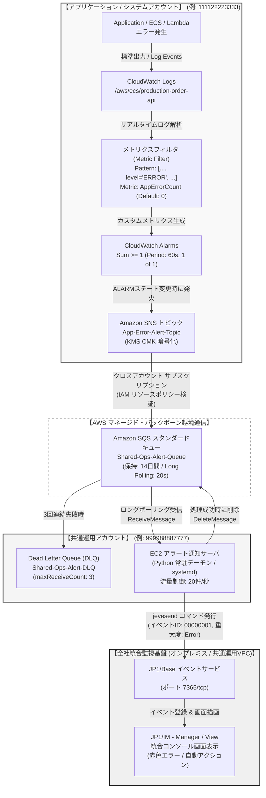
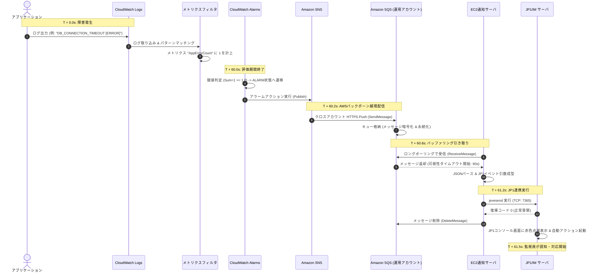

# AWS CloudWatch Logs → JP1/IM 統合アラート監視アーキテクチャ設計仕様書

---

## 1. はじめに（エグゼクティブサマリー）

本設計書は、AWS上の各種システムが出力するログ（CloudWatch Logs）から特定のエラー文字列を検知し、メトリクス化・アラーム判定を経て、マルチアカウント環境における共通運用アカウントの Amazon SQS に安全にバッファリングした上で、EC2アラート通知サーバを介して全社統合監視基盤である **日立 JP1/Integrated Management (JP1/IM)** へ確実にエラー通知を行う統合監視アーキテクチャの完全仕様を定めたものです。

### 1.1 設計の背景とゴール
- **高可用性とメッセージ損失ゼロ（RPO=0）**: JP1サーバの計画停止・パッチ適用中やネットワーク瞬断時であっても、発生したアラートを1件たりとも失わない耐障害性を実現する。
- **アラートストームの吸収（流量制御）**: 大規模障害時に発生する毎秒数千〜数万件のエラーログによる監視サーバ（JP1）のパンク・ダウンを防止する。
- **マルチアカウント統制**: アプリケーション環境（開発・ステージング・本番）と共通運用環境のセキュリティ境界を強固に保ち、VPC間ルーティングに依存しないセキュアなAWSマネージド連携を実現する。
- **運用の標準化**: クラウドネイティブな監視（CloudWatch）と、24時間365日の統合運用監視体制（JP1コンソール）をシームレスに統合する。

---

## 2. 小学生にもわかる！たとえ話で理解するシステム全体の仕組み

この高度なITシステムが「何をしているのか」「なぜこの部品たちが必要なのか」を、**マンモス小学校で起きた大事件を校長先生に確実に伝える学校の連絡システム**にたとえて説明します。

```
【教室】                   【職員室】                                       【校長室】
生徒の日記 (Logs)         頑丈な郵便ポスト (SQS)                           特大電子掲示板 (JP1/IM)
     │                           │                                              ▲
     ▼                           │                                              │
赤ペン先生 (メトリクスフィルタ)   │                                              │
     │                           │                                              │
     ▼                           │                                       当直の先生 (EC2)
見張り隊長 (Alarms)              │                                              │
     │                           │                                              │
     ▼                           ▼                                              │
校内放送 (SNS) ───────────> ポストに手紙が投函される ───────> 手紙を取り出し清書 ─────┘
```

### 2.1 登場人物・場所と役割の対比表

| システムの部品名 | 身近な学校のたとえ | 学校での具体的なお仕事・役割 | 実際のコンピュータ世界での動き | もしこの部品が無かったらどうなる？ |
| :--- | :--- | :--- | :--- | :--- |
| **CloudWatch Logs** | 毎日の**「連絡帳・日記」** | 生徒（プログラム）が「給食を食べた」「転んだ」「ケンカした」など、今日あった出来事をなんでも書き込むノート。 | サーバやアプリが動いたすべての記録（ログ）がリアルタイムに集まる保管庫。 | 何が起きたのか後から誰も確認できず、事件が迷宮入りしてしまう。 |
| **メトリクスフィルタ** | 連絡帳の**「赤ペン先生」** | 連絡帳の中から「ケンカした」「ケガした」という危ない言葉だけを探して、正の字を書いて数を数える先生。 | ログの中に `ERROR` や `FATAL` という特定の文字がないか見張り、見つけたら数字の「1」をカウントする。 | 普通のつぶやきと大事件の区別がつかず、どれだけ事件が起きているかわからない。 |
| **CloudWatch Alarms** | 校内の**「パトロール隊長」** | 赤ペン先生のカウンターを見て、「5分間に3回以上ケンカが起きたら、ただごとじゃないから非常ベルを押すぞ！」と見張る隊長。 | メトリクスの数字を監視し、決めたルール（閾値: 1分間に1回以上など）を超えたら警報状態になる。 | 事件が多発しても誰も気付かず、手遅れになるまで放置されてしまう。 |
| **Amazon SNS** | 職員室への**「校内放送スピーカー」** | 非常ベルが鳴ると、「ピンポンパンポン！1組で事件発生！」と職員室に向けて大音量でアナウンスを飛ばすスピーカー。 | アラームが鳴った瞬間に、登録された宛先（共通運用アカウントのポスト）へ電波を飛ばして伝える。 | 警報が鳴っても自分の教室の中だけで響いて、職員室の先生に届かない。 |
| **Amazon SQS**<br>*(共通運用アカウント)* | 職員室の**「頑丈な郵便ポスト」**<br>★一番大切なクッション！ | 放送を聞いた係が手紙を投函するポスト。何千通でも手紙が入り、雨が降っても14日間絶対に手紙が濡れたり消えたりしない。 | アラートを一時的に安全に溜めておく「メッセージキュー」。受け取る側が忙しくても絶対に落とさない。 | ★大パニック！100人の生徒が一斉に校長室に走り込んで校長先生が気絶する（サーバがパンクして落ちる）。 |
| **アラート通知サーバ**<br>*(EC2)* | ポストを見張る**「当直の先生」** | ポストの前で待っていて、手紙が入ったら1通ずつ丁寧に取り出し、校長先生が読みやすい「特大報告カード」に清書して書き直す配達係の先生。 | SQSからアラートを取り出し、JP1が理解できる特別なフォーマット（JP1イベント形式）にデータを変換する。 | 手紙の内容が難しすぎて校長先生の電子黒板に映せず、誰も読めない。 |
| **JP1/IM サーバ** | 校長室の**「巨大な電子掲示板」** | 全校生徒のトラブルが一目でピカピカ光ってわかる司令塔の画面。校長先生が「すぐに現場へ急行！」と先生たちに指示を出す。 | 全社のエラーが一覧表示され、監視員が赤色・黄色のランプを見て即座に対応を開始する統合監視画面。 | 会社中のどのシステムで何が壊れているのかバラバラで、誰も全体を把握できない。 |

### 2.2 なぜ生徒が直接校長室に走っていかないの？（ポストと当直の先生の秘密）
もし、システムが壊れて大量のエラーが起きたとき、生徒（プログラム）が全員で校長室（JP1）へ直接ワーッと叫びながら走り込んだらどうなるでしょうか？
1. **校長先生が倒れてしまう（サーバの過負荷・パンク）**:
   一度に1,000人もの生徒が叫んだら、校長先生は話を聞き取れず倒れてしまいます。
2. **校長先生がトイレに行っているとき（メンテナンス中）**:
   校長先生が席を外しているときに叫んでも、誰も聞いてくれません。生徒が教室に戻ってしまったら、重大な事件が誰にも伝わらず消えてしまいます（メッセージの消失）。
3. **だから「ポスト（SQS）」と「当直の先生（EC2）」が必要！**:
   どんなにたくさんの手紙が来ても、ポストがすべて大切に保管してくれます。そして当直の先生が「校長先生、落ち着いて1枚ずつ読んでくださいね」と順番に手渡してくれるので、校長先生は絶対に倒れず、1件も事件を見落とさずにすむのです。

---

## 3. 登場の歴史と背景：なぜこのアーキテクチャが必要になったのか？

エンタープライズ企業のシステム監視は、過去20年間で大きなパラダイムシフトを経験してきました。本アーキテクチャは、数々の現場の障害や失敗の歴史から導き出された必然の構成です。

```
【第1世代：オンプレミス時代】
 [物理サーバ] (JP1/Baseエージェント常駐) ───[社内LAN / 直接ソケット通信]───> [JP1/IMマネージャー]
 ※課題：クラウドのオートスケーリング・コンテナに対応不可。エージェント配布とライセンス費用が肥大化。
           │
           ▼
【第2世代：クラウド移行初期（直接連携のアンチパターン）】
 [CloudWatch Alarm] ───[Webhook / Lambda直接連携]───> [オンプレミス JP1/IM]
 ※重大事故：大規模障害時のアラートストームでJP1ダウン、JP1保守時にアラート完全消失、VPC配線がスパゲッティ化。
           │
           ▼
【第3世代：現代の標準構成（疎結合・非同期バッファリング）】
 [CloudWatch Logs] ─> [Metric Filter] ─> [Alarm] ─> [SNS]
                                                      │ (AWSバックボーン / クロスアカウント)
                                                      ▼
 [JP1/IM] <─── [EC2通知ワーカー] <─── [SQSバッファ (最大14日保持)]
 ※解決：完全な疎結合、流量制御によるJP1保護、メッセージ消失ゼロ(RPO=0)、VPCルーティング不要。
```

### 3.1 監視アーキテクチャの進化フェーズ

#### 第1世代：オンプレミス時代（2000年代〜2010年代前半）
- **形態**: JP1/Base エージェント集中監視。
- **実態**: 物理サーバや仮想マシン（VMware等）の1台1台に JP1/Base を常駐インストール。ローカルのログファイルを JP1/Base の「ログファイルトラップ機能」が直接読み込み、社内閉域網（LAN）を経由して JP1/IM マネージャーへ直接ソケット通信（7365/tcp等）で通知。
- **限界**: サーバの台数とIPアドレスが固定であることが前提。AWSへ移行し、コンテナ（ECS/EKS）やサーバレス（Lambda）、オートスケーリングが登場すると、数分〜数時間で破棄・再作成されるインスタンスに個別エージェントを導入・ライセンス管理することは技術的・コスト的に不可能となった。

#### 第2世代：クラウド移行初期（2010年代中盤〜後半）の失敗とアンチパターン
- **形態**: CloudWatch Alarm からの直接プッシュ連携。
- **実態**: ログを CloudWatch Logs に集約し、CloudWatch Alarm から直接 Webhook や AWS Lambda をキックして、Direct Connect や VPN 経由でオンプレミス JP1 へ HTTPS/TCP で直接プッシュ通知。
- **直面した3大事故**:
  1. **アラートストームによるJP1サーバのパンク・ダウン**:
     DB停止やネットワーク分断などの壊滅的障害が発生した際、数百のコンテナが一斉に毎秒数万件のエラーログを出力。直接連携していたため、JP1サーバの受付プロセスが溢れてダウンし、最も知りたかった「最初に起きた根本原因のアラート」がパケットドロップして消失。
  2. **JP1計画保守時のアラート完全消失（データロスト）**:
     JP1サーバのOSパッチ適用や深夜メンテナンス中に、AWS側で障害が発生。CloudWatch Alarm や Lambda は相手が応答しないため数回リトライした後に送信を諦め、アラートが闇に葬られた。
  3. **ネットワークのスパゲッティ化とセキュリティ境界の崩壊**:
     マルチアカウント環境において、数十〜数百のアカウントそれぞれからオンプレミスのJP1サーバへVPCピアリングやDirect Connect経由のルーティングを張り巡らせた結果、IPアドレス帯の枯渇（CIDR重複問題）、セキュリティグループの肥大化、ルーティング管理の破綻を招いた。

#### 第3世代：現代のエンタープライズ標準（本アーキテクチャ）
- **形態**: SNS + クロスアカウントSQS + EC2バッファリングワーカーによる完全疎結合構成。
- **特徴**:
  - アプリケーション側は「SNSへ投げるだけ」で完結。
  - アカウント越境通信は、VPCルーティングを使わず**AWSバックボーン完結のマネージドサービス（SNS→SQS）**で安全に越境。
  - SQSが衝撃吸収材（バッファ）として機能し、最大14日間メッセージを永続保持。
  - EC2上の通知ワーカーデーモンが、JP1サーバの受入能力に合わせた速度（流量制御: Rate Limiting）でメッセージを丁寧に引き取ってJP1へ注入。

### 3.2 なぜ「SNS + SQS」が必要なのか？（4大技術的メリット）

1. **疎結合（Decoupling）と責務の分離**:
   - アプリ開発チーム（アプリアカウント）の関心事: 「エラーログを出し、アラームが飛ぶこと」。JP1のイベントIDやポート番号を知る必要はない。
   - 共通運用チーム（運用アカウント）の関心事: 「届いたアラートをJP1の監視運用ルールに合わせてフォーマットし、オペレータへ届けること」。
2. **流量制御（バックプレッシャーの解消）**:
   - 急激なアラートスパイクが発生しても、SQSがすべてを受け止めるため、後段のJP1サーバには一定レート（例: 秒間20件など）で安全にリレー可能。
3. **耐障害性と無停止メンテナンス（Zero Data Loss）**:
   - JP1サーバが数時間停止していても、SQS内に安全にメッセージが滞留。JP1復旧後に自動的に全メッセージがJP1へ届けられ、人手によるリカバリ作業が不要。
4. **ファンアウト拡張性**:
   - 今後、JP1だけでなく「Slack通知」「PagerDuty連携」「ServiceNow自動チケット起票」を追加したくなった場合も、SNSトピックに新しいサブスクリプションを追加するだけで、既存のJP1監視系に一切影響を与えずに拡張可能。

---

## 4. 全体アーキテクチャ構成と動作原理

### 4.1 全体アーキテクチャ図（Mermaidフローチャート）



### 4.2 リアルタイム時系列シーケンス図（障害発生から画面表示まで）



---

## 5. 各コンポーネント詳細仕様と設定パラメータ一覧

本構成を構築・運用するにあたり、各コンポーネントで指定可能なパラメータおよび現場で採用すべき推奨設定値を網羅した完全一覧です。

### 5.1 パラメータ定義マトリクス表

| コンポーネント | 設定パラメータ名 | 設定内容・役割 | 指定可能な値・選択肢 | 現場での推奨設定値 (実例) | 設定理由・運用上の留意事項 |
| :--- | :--- | :--- | :--- | :--- | :--- |
| **CloudWatch Logs** | `log_group_name` | ログを束ねるグループ名 | 任意の文字列 (1〜512文字) | `/aws/ecs/production-order-api` | システム・環境・サービス名が階層構造で判別できる命名規約に準拠。 |
| **CloudWatch Logs** | `retention_in_days` | ログデータの保持期限 | 1〜3653日, 無期限 | `90` (日) | 監査要件とストレージ費用のバランス。長期保管ログはS3へエクスポート。 |
| **CloudWatch Logs** | `kms_key_id` | 保存時暗号化に使用するKMSキー | KMS Key ARN または未指定 | `arn:aws:kms:...:key/...` | 金融・エンタープライズセキュリティ要件でCMK暗号化を適用。 |
| **メトリクスフィルタ** | `filter_name` | フィルタの一意な識別名 | 任意の文字列 (1〜512文字) | `MF-AppErrorCount-OrderApi` | メトリクスと対象ロググループが一目でわかる名称。 |
| **メトリクスフィルタ** | `filter_pattern` | 抽出対象の文字列・パターン | スペース区切り、JSON条件式、正規表現 | `[timestamp, reqId, level = "ERROR" \|\| level = "FATAL", ...]` | JSONログの場合は `{ $.level = "ERROR" }` を推奨。テキストログは左記。 |
| **メトリクスフィルタ** | `metric_name` | 生成するカスタムメトリクス名 | 任意の文字列 (英数字・記号) | `AppErrorCount` | CloudWatch Alarms側で参照するメトリクス名。 |
| **メトリクスフィルタ** | `metric_namespace` | メトリクスの所属名前空間 | 任意の文字列 (`AWS/` 以外) | `CustomApp/OrderService` | AWS標準名前空間と混同しないよう独自プレフィックスを使用。 |
| **メトリクスフィルタ** | `metric_value` | マッチ時に加算する数値 | 数値 (通常は 1) | `1` | 1件マッチするごとにカウントを1増やすため。 |
| **メトリクスフィルタ** | `default_value`<br>★超重要！ | ログが出ない期間に代入する値 | `0` または 空 (未指定) | `0` | **【必須設定】** 未指定だとログが出ない時にデータ欠落(Missing Data)となりアラーム評価が不安定化する。 |
| **メトリクスフィルタ** | `unit` | メトリクスの単位 | Count, Seconds, Bytes 等 | `Count` | 回数をカウントするため。 |
| **CloudWatch Alarms** | `alarm_name` | アラームの表示名 | 任意の文字列 (1〜255文字) | `ALARM-OrderApi-AppErrorCount-High` | アカウント名、システム名、監視項目、重大度を含める。JP1のタイトルになる。 |
| **CloudWatch Alarms** | `comparison_operator` | 閾値との比較条件 | `GreaterThanOrEqualToThreshold` 等 | `GreaterThanOrEqualToThreshold` (>=) | 閾値1に対して、1回でもエラーが出たら発火させるため。 |
| **CloudWatch Alarms** | `evaluation_periods` | 判定対象とするデータポイント数 (N) | 1 以上の整数 | `1` (即時検知) または `3` (誤報抑止) | 即時通報が必要な重大エラーは1。断続的ノイズを除外したい場合は3。 |
| **CloudWatch Alarms** | `datapoints_to_alarm` | N個中何個閾値を超えたら発火するか (M) | 1 <= M <= N の整数 | `1` (1 of 1) または `3` (3 of 3) | M out of N 評価。1 of 1 で最速検知、3 of 3 でスパイク除外。 |
| **CloudWatch Alarms** | `period` | 1データポイントの集計期間 (秒) | 10, 30, 60, 300, 900, 3600 | `60` (1分間) | ログ監視では最速の検知が求められるため60秒推奨。 |
| **CloudWatch Alarms** | `statistic` | メトリクスの統計方法 | SampleCount, Average, Sum 等 | `Sum` (合計) | 1分間のエラー発生「総数」を評価するため。 |
| **CloudWatch Alarms** | `threshold` | 発火の基準となる敷居値 | 数値 (整数または小数) | `1.0` | 1回でもERRORが出たらアラートを上げる場合は1。許容値がある場合は5など。 |
| **CloudWatch Alarms** | `treat_missing_data` | データが存在しない期間の扱い方 | missing, ignore, breaching, notBreaching | `notBreaching` (正常とみなす) | メトリクスフィルタの `default_value=0` と併用し、ログがない時は正常と評価。 |
| **CloudWatch Alarms** | `alarm_actions` | ALARM遷移時の通知先アクション | SNS Topic ARN 等 | `arn:aws:sns:...:AppAlertTopic` | 同一アカウント内のSNSトピックARNを指定。 |
| **Amazon SNS** | `topic_name` | SNSトピックの名称 | 任意の文字列 (英数字・ハイフン) | `App-Error-Alert-Topic` | 用途（システム名・アラート用）が明確な名称。 |
| **Amazon SNS** | `fifo_topic` | FIFOかスタンダードか | true (FIFO), false (スタンダード) | `false` (スタンダードトピック) | アラートストーム時の超高スループットを最優先。 |
| **Amazon SNS** | `kms_master_key_id` | 暗号化キーの指定 | alias/aws/sns または カスタマーCMK | `arn:aws:kms:...` (CMK) または 未暗号化 | ※重要：クロスアカウント配信時、マネージドキーはキーポリシー変更不可のため使えない。CMK必須。 |
| **Amazon SNS** | `protocol` | サブスクリプションプロトコル | sqs, email, lambda, https 等 | `sqs` | 運用アカウントのSQSキューへ届けるため。 |
| **Amazon SNS** | `endpoint` | サブスクリプションのエンドポイント | 宛先ARN (SQSキューARN) | `arn:aws:sqs:...:Shared-Ops-Alert-Queue` | 共通運用アカウントのSQSキューARNを指定。 |
| **Amazon SNS** | `raw_message_delivery` | 生メッセージ配信の有効無効 | true, false | `false` (ヘッダー付きJSON) | CloudWatch Alarmのメタ情報を含むJSONを受信するため。 |
| **Amazon SQS** | `queue_name` | SQSキューの名称 | 任意の文字列 (英数字・ハイフン) | `Shared-Ops-Alert-Queue` | 共通運用アカウントで監視アラート受信用であることが分かる名称。 |
| **Amazon SQS** | `fifo_queue` | FIFOキューかスタンダードか | true, false | `false` (スタンダードキュー) | 秒間数千件のアラートストームでも上限なしで受領するため。 |
| **Amazon SQS** | `message_retention_period` | メッセージ保持期間 (秒) | 60秒 〜 1,209,600秒 (14日間) | `1209600` (14日間: 最大値) | JP1やEC2が長期メンテで停止していても、メッセージを完全保持するため。 |
| **Amazon SQS** | `visibility_timeout` | 可視性タイムアウト (秒) | 0秒 〜 43,200秒 (12時間) | `60` (秒) | EC2ワーカーがメッセージを取得してからJP1送信・削除を完了するまでの猶予時間。 |
| **Amazon SQS** | `receive_wait_time_seconds` | 受信待機時間 (ロングポーリング) | 0秒 〜 20秒 | `20` (秒: 最大値) | **【コスト・即時性の要】** 無駄な空振りAPIをゼロにし、到着時は即時受信。 |
| **Amazon SQS** | `max_receive_count` | DLQへ送るまでの最大受信回数 | 1 以上の整数 | `3` (回) | 3回連続で処理失敗した異常メッセージをDLQへ自動隔離。 |
| **Amazon SQS** | `dead_letter_queue_arn` | 異常メッセージの退避先キュー | DLQのキューARN | `arn:aws:sqs:...:Shared-Ops-Alert-DLQ` | 隔離されたメッセージを後から手動調査・再送するため。 |
| **EC2 通知サーバ** | `instance_type` | EC2インスタンスタイプ | t4g.small / t3.micro 等 | `t4g.small` (Graviton3) | CPU/メモリ負荷は極めて軽微。ネットワーク安定性とコスト効率を両立。 |
| **EC2 通知サーバ** | `polling_daemon_workers` | 並行ワーカースレッド数 | 1 〜 10 スレッド | `2 〜 4` ワーカー | SQSから同時に受信・JP1へ投げるスレッド数。 |
| **EC2 通知サーバ** | `max_number_of_messages` | 1回のポーリングで取得する最大件数 | 1 〜 10 件 | `10` (件) | 大量発生時の処理効率向上のため最大値10を指定。 |
| **EC2 通知サーバ** | `rate_limit_events_per_sec` | JP1への送信レートリミット | 任意の実数 (件/秒) | `20` (件/秒) | JP1のイベント受信プロセスが過負荷でダウンするのを防ぐ流量制御。 |
| **JP1/Base & JP1/IM** | `event_id` | JP1イベントの一意なID | 16進数 0:0〜7FFFFFFF:FFFFFFFF | `00000001` (ユーザー自由定義) | 運用チームで定めた「AWSアラート通知用イベントID」を付与。 |
| **JP1/Base & JP1/IM** | `severity` | イベントの重大度 (Severity) | Emergency, Alert, Critical, Error, Warning 等 | `Error` (または `Warning`) | アラーム名や内容に応じて動的にマッピング。JP1画面の表示色に直結。 |
| **JP1/Base & JP1/IM** | `message (-m)` | コンソールに表示される主メッセージ | 文字列 (最大1,023バイト) | `[AWS-ALERT] [111122223333] ALARM-...` | 監視員が一目でどのアカウントの何が起きたか把握できるフォーマット。 |
| **JP1/Base & JP1/IM** | `extended_attributes (-e)` | JP1イベント拡張属性 | KEY=VALUE 形式の複数属性 | `E.AWS_ACCOUNT_ID=111122223333` 等 | JP1/IM側での自動アクション条件や詳細調査画面での参照用属性。 |

---

## 6. クロスアカウント・セキュリティ＆権限設計

本アーキテクチャでは、**アプリケーションアカウント（送信元: 111122223333）** から **共通運用アカウント（受信元: 999988887777）** へのクロスアカウント通信が発生します。AWSのセキュリティベストプラクティスに基づき、最小特権の原則を徹底したポリシー設計を行います。

### 6.1 SQS キューリソースポリシー（不正書き込み防止）
共通運用アカウントのSQSキューに対し、アプリケーションアカウントのSNSトピックからのみ `sqs:SendMessage` を許可します。送信元SNSトピックのARNを `Condition` 句（`aws:SourceArn`）で厳格に拘束することで、他者からの不正なメッセージ投入を完全にブロックします。

```json
{
  "Version": "2012-10-17",
  "Id": "AllowCrossAccountSNSToPublishToSQS",
  "Statement": [
    {
      "Sid": "AllowAppAccountSNSMessages",
      "Effect": "Allow",
      "Principal": {
        "Service": "sns.amazonaws.com"
      },
      "Action": "sqs:SendMessage",
      "Resource": "arn:aws:sqs:ap-northeast-1:999988887777:Shared-Ops-Alert-Queue",
      "Condition": {
        "ArnEquals": {
          "aws:SourceArn": "arn:aws:sns:ap-northeast-1:111122223333:App-Error-Alert-Topic"
        }
      }
    }
  ]
}
```

> [!IMPORTANT]
> **クロスアカウント暗号化における重大な注意点（KMS CMKの必須性）**
> SQSまたはSNSで保管時暗号化（SSE）を有効にする場合、デフォルトのAWSマネージドキー（`alias/aws/sqs` や `alias/aws/sns`）を使用してはいけません。AWSマネージドキーはキーポリシーを編集できないため、クロスアカウントのアクセスがAWS側で拒否されます。必ず**カスタマー管理キー（KMS CMK）**を作成し、下記のようにSNSサービスプリンシパルに対する権限を付与してください。

### 6.2 SQS暗号化用 KMS カスタマー管理キー（CMK）ポリシー

```json
{
  "Version": "2012-10-17",
  "Id": "AllowSNSToUseKMSKeyForSQSEncryption",
  "Statement": [
    {
      "Sid": "AllowRootAccountAdministration",
      "Effect": "Allow",
      "Principal": {
        "AWS": "arn:aws:iam::999988887777:root"
      },
      "Action": "kms:*",
      "Resource": "*"
    },
    {
      "Sid": "AllowSNSServiceToGenerateDataKeyAndDecrypt",
      "Effect": "Allow",
      "Principal": {
        "Service": "sns.amazonaws.com"
      },
      "Action": [
        "kms:GenerateDataKey*",
        "kms:Decrypt"
      ],
      "Resource": "*",
      "Condition": {
        "ArnEquals": {
          "aws:SourceArn": "arn:aws:sns:ap-northeast-1:111122223333:App-Error-Alert-Topic"
        }
      }
    }
  ]
}
```

### 6.3 EC2 アラート通知サーバ用 IAM ロールポリシー（最小権限）

```json
{
  "Version": "2012-10-17",
  "Statement": [
    {
      "Sid": "AllowSQSMessageOperations",
      "Effect": "Allow",
      "Action": [
        "sqs:ReceiveMessage",
        "sqs:DeleteMessage",
        "sqs:GetQueueAttributes",
        "sqs:GetQueueUrl"
      ],
      "Resource": [
        "arn:aws:sqs:ap-northeast-1:999988887777:Shared-Ops-Alert-Queue",
        "arn:aws:sqs:ap-northeast-1:999988887777:Shared-Ops-Alert-DLQ"
      ]
    },
    {
      "Sid": "AllowKMSDecryptForSQS",
      "Effect": "Allow",
      "Action": [
        "kms:Decrypt",
        "kms:DescribeKey"
      ],
      "Resource": "arn:aws:kms:ap-northeast-1:999988887777:key/12345678-1234-1234-1234-123456789abc"
    }
  ]
}
```

---

## 7. メッセージデータ構造とJP1イベント変換仕様

### 7.1 SQSから受信する生メッセージ構造 (SNS Envelope + CloudWatch Alarm JSON)

EC2通知サーバが SQS から受信するメッセージの `Body` には、SNSのエンベロープ情報が含まれ、その `Message` 属性内に CloudWatch Alarm の詳細JSONが文字列として格納されています。

```json
{
  "Type" : "Notification",
  "MessageId" : "1a2b3c4d-5e6f-7a8b-9c0d-1e2f3a4b5c6d",
  "TopicArn" : "arn:aws:sns:ap-northeast-1:111122223333:App-Error-Alert-Topic",
  "Subject" : "ALARM: \"ALARM-OrderApi-AppErrorCount-High\" in Asia Pacific (Tokyo)",
  "Message" : "{\"AlarmName\":\"ALARM-OrderApi-AppErrorCount-High\",\"AlarmDescription\":\"注文APIエラーログ検知アラーム\",\"AWSAccountId\":\"111122223333\",\"NewStateValue\":\"ALARM\",\"NewStateReason\":\"Threshold Crossed: 1 datapoint [5.0 (07/10/26 04:00:00)] was greater than or equal to the threshold (1.0).\",\"StateChangeTime\":\"2026-10-07T04:01:15.123+0000\",\"Region\":\"Asia Pacific (Tokyo)\",\"AlarmArn\":\"arn:aws:cloudwatch:ap-northeast-1:111122223333:alarm:ALARM-OrderApi-AppErrorCount-High\",\"OldStateValue\":\"OK\",\"Trigger\":{\"MetricName\":\"AppErrorCount\",\"Namespace\":\"CustomApp/OrderService\",\"StatisticType\":\"Statistic\",\"Statistic\":\"SUM\",\"Unit\":null,\"Dimensions\":[],\"Period\":60,\"EvaluationPeriods\":1,\"ComparisonOperator\":\"GreaterThanOrEqualToThreshold\",\"Threshold\":1.0}}",
  "Timestamp" : "2026-10-07T04:01:15.567Z"
}
```

### 7.2 JP1イベント属性マッピング定義表

| JP1イベント属性名 | JP1属性種別 | 取得元 (CloudWatch JSONキー) | 変換ロジック・成型ルール | 設定例 (出力値) | JP1コンソール上での用途 |
| :--- | :--- | :--- | :--- | :--- | :--- |
| **イベントID (`-i`)** | 基本属性 | 固定値 (システム定義) | AWSアラート共通のイベントIDを16進数で指定 | `00000001` | イベントフィルタリング・自動アクションのトリガー条件 |
| **重大度 (`-s / SEVERITY`)** | 拡張属性 | `AlarmName` または `NewStateValue` | `NewStateValue=='ALARM'` かつ AlarmNameに `FATAL` や `Critical` を含む場合は Emergency/Critical、通常は Error。復旧(`OK`)時は Info | `Error` | JP1イベントコンソール上の表示色（赤: Error、黄: Warning、青: Info） |
| **メッセージ (`-m / MESSAGE`)** | 基本属性 | `AWSAccountId`, `AlarmName`, `NewStateReason` | 成型文字列: `[AWS-ALERT] [{AWSAccountId}] {AlarmName} : {NewStateReason}` | `[AWS-ALERT] [111122223333] ALARM-OrderApi-AppErrorCount-High : Threshold Crossed...` | 監視員が画面一覧で即座に状況を把握するメイン表示テキスト |
| **発生日時 (`DATE / TIME`)** | 基本属性 | `StateChangeTime` | ISO8601形式のタイムスタンプをローカルタイム (JST) へ変換して引き渡し | `2026/10/07 13:01:15` | インシデント発生時刻の記録・ソート |
| `E.AWS_ACCOUNT_ID` | 固有拡張属性 | `AWSAccountId` | そのまま設定 | `111122223333` | マルチアカウント環境における障害発生元AWSアカウントの特定・集計 |
| `E.AWS_REGION` | 固有拡張属性 | `Region` | そのまま設定 | `Asia Pacific (Tokyo)` | リージョン別インシデント分析 |
| `E.ALARM_NAME` | 固有拡張属性 | `AlarmName` | そのまま設定 | `ALARM-OrderApi-AppErrorCount-High` | アラーム名に基づく自動エスカレーション・マニュアルリンク表示 |
| `E.METRIC_NAME` | 固有拡張属性 | `Trigger.MetricName` | そのまま設定 | `AppErrorCount` | メトリクス種別の特定 |
| `E.NAMESPACE` | 固有拡張属性 | `Trigger.Namespace` | そのまま設定 | `CustomApp/OrderService` | システム・サービスの特定 |
| `E.LOG_GROUP` | 固有拡張属性 | `AlarmDescription` 等から抽出 | アラーム設定またはInsights連携によりロググループ名を補完 | `/aws/ecs/production-order-api` | 監視員が即座に対象ログをCloudWatchで開くためのディープリンク生成 |

### 7.3 JP1イベント発行コマンド（jevesend）実行例

EC2通知サーバ上で実行される `jevesend` の実際のシェルコマンド構文です。

```bash
/opt/jp1base/bin/jevesend \
  -d "JP1_DEFAULT" \
  -i 00000001 \
  -s Error \
  -m "[AWS-ALERT] [111122223333] ALARM-OrderApi-AppErrorCount-High : Threshold Crossed (Count >= 1.0)" \
  -e "SEVERITY=Error" \
  -e "E.AWS_ACCOUNT_ID=111122223333" \
  -e "E.ALARM_NAME=ALARM-OrderApi-AppErrorCount-High" \
  -e "E.METRIC_NAME=AppErrorCount" \
  -e "E.NAMESPACE=CustomApp/OrderService" \
  -e "E.LOG_GROUP=/aws/ecs/production-order-api" \
  -e "E.AWS_REGION=ap-northeast-1"
```

### 7.4 EC2アラート通知デーモン 実装コード（Python 3 + boto3 + jevesend）

EC2通知サーバ上で systemd 常駐サービスとして動作する Python スクリプトのプロダクション実装例です。ロングポーリング、JSONの多段パース、流量制御（レートリミット）、JP1イベント発行、成功時削除、エラーハンドリングを網羅しています。

```python
#!/usr/bin/env python3
# -*- coding: utf-8 -*-
"""
sqs_to_jp1_forwarder.py
Amazon SQSからCloudWatchアラームメッセージを受信し、JP1/IMへ通知する常駐デーモン
"""

import os
import sys
import json
import time
import logging
import subprocess
import boto3
from botocore.exceptions import BotoCoreError, ClientError

# ログ設定
logging.basicConfig(
    level=logging.INFO,
    format="%(asctime)s [%(levelname)s] [%(process)d] %(message)s",
    handlers=[
        logging.StreamHandler(sys.stdout),
        logging.FileHandler("/var/log/sqs_to_jp1_forwarder.log", encoding="utf-8")
    ]
)
logger = logging.getLogger("sqs_to_jp1_forwarder")

# 環境変数・設定値
QUEUE_URL = os.environ.get(
    "SQS_QUEUE_URL",
    "https://sqs.ap-northeast-1.amazonaws.com/999988887777/Shared-Ops-Alert-Queue"
)
REGION = os.environ.get("AWS_REGION", "ap-northeast-1")
JEVESEND_PATH = os.environ.get("JEVESEND_PATH", "/opt/jp1base/bin/jevesend")
JP1_EVENT_ID = os.environ.get("JP1_EVENT_ID", "00000001")
RATE_LIMIT_SLEEP = 0.05  # 最大20件/秒の流量制御


def parse_alarm_payload(message_body: str) -> dict:
    """SNS Envelope内部のCloudWatch Alarm JSONをパースする"""
    data = json.loads(message_body)
    if "Message" in data and isinstance(data["Message"], str):
        try:
            return json.loads(data["Message"])
        except json.JSONDecodeError:
            return data
    return data


def forward_to_jp1(alarm_data: dict) -> None:
    """JP1/Baseのjevesendコマンドを呼び出してJP1イベントを発行する"""
    alarm_name = alarm_data.get("AlarmName", "UNKNOWN_ALARM")
    account_id = alarm_data.get("AWSAccountId", "UNKNOWN_ACCOUNT")
    new_state = alarm_data.get("NewStateValue", "ALARM")
    reason = alarm_data.get("NewStateReason", "No reason provided")
    region = alarm_data.get("Region", "Unknown-Region")
    trigger = alarm_data.get("Trigger", {})
    metric_name = trigger.get("MetricName", "UnknownMetric")
    namespace = trigger.get("Namespace", "UnknownNamespace")

    # 重大度マッピング
    if new_state == "ALARM":
        if any(keyword in alarm_name.upper() for keyword in ["FATAL", "CRITICAL", "EMERGENCY"]):
            severity = "Emergency"
        else:
            severity = "Error"
    elif new_state == "OK":
        severity = "Notice"
    else:
        severity = "Warning"

    # メッセージ本文（JP1上限1023バイト考慮）
    summary_msg = f"[AWS-ALERT] [{account_id}] {alarm_name} : {reason}"
    if len(summary_msg.encode("utf-8")) > 1000:
        summary_msg = summary_msg[:300] + "...(truncated)"

    cmd = [
        JEVESEND_PATH,
        "-d", "JP1_DEFAULT",
        "-i", JP1_EVENT_ID,
        "-s", severity,
        "-m", summary_msg,
        "-e", f"SEVERITY={severity}",
        "-e", f"E.AWS_ACCOUNT_ID={account_id}",
        "-e", f"E.ALARM_NAME={alarm_name}",
        "-e", f"E.METRIC_NAME={metric_name}",
        "-e", f"E.NAMESPACE={namespace}",
        "-e", f"E.AWS_REGION={region}",
        "-e", f"E.NEW_STATE={new_state}"
    ]

    result = subprocess.run(cmd, capture_output=True, text=True, check=True)
    logger.info(f"JP1 event emitted successfully. Alarm: {alarm_name}, State: {new_state}, ReturnCode: {result.returncode}")


def main():
    logger.info("Initializing SQS to JP1 Alert Forwarder Daemon...")
    sqs = boto3.client("sqs", region_name=REGION)

    while True:
        try:
            response = sqs.receive_message(
                QueueUrl=QUEUE_URL,
                MaxNumberOfMessages=10,
                WaitTimeSeconds=20,  # Long Polling
                VisibilityTimeout=60,
                AttributeNames=["All"],
                MessageAttributeNames=["All"]
            )

            messages = response.get("Messages", [])
            if not messages:
                continue

            logger.info(f"Received {len(messages)} message(s) from SQS.")

            for msg in messages:
                receipt_handle = msg["ReceiptHandle"]
                msg_id = msg["MessageId"]
                try:
                    alarm_data = parse_alarm_payload(msg["Body"])
                    forward_to_jp1(alarm_data)

                    # JP1イベント発行成功時のみキューから削除
                    sqs.delete_message(
                        QueueUrl=QUEUE_URL,
                        ReceiptHandle=receipt_handle
                    )
                    logger.info(f"Message {msg_id} deleted from SQS successfully.")
                    time.sleep(RATE_LIMIT_SLEEP)  # 流量制御

                except subprocess.CalledProcessError as e:
                    # JP1送信失敗時はキューから削除せず、可視性タイムアウト後にリトライさせる
                    logger.error(f"Failed to execute jevesend for msg {msg_id}. Stderr: {e.stderr}")
                except Exception as e:
                    logger.error(f"Unexpected error processing message {msg_id}: {e}", exc_info=True)

        except (BotoCoreError, ClientError) as aws_err:
            logger.error(f"AWS SQS API error: {aws_err}. Sleeping for 10 seconds before reconnecting...")
            time.sleep(10)
        except Exception as general_err:
            logger.error(f"Fatal daemon loop error: {general_err}", exc_info=True)
            time.sleep(5)


if __name__ == "__main__":
    main()
```

---

## 8. 非機能要件・運用保守・障害時設計

### 8.1 障害シナリオと防御メカニズムマトリクス

| 設計領域 | 想定される障害シナリオ / 課題 | アーキテクチャ上の防御メカニズム | 運用手順・リカバリアクション | 復旧目標 (RTO/RPO) |
| :--- | :--- | :--- | :--- | :--- |
| **アラートストーム (大量発生)** | カスケード障害時、1秒間に数千〜数万件のエラーログが吹き出し、監視インフラ全体に過負荷がかかる。 | 1. メトリクスフィルタの集計（ログ件数を数値化し集約）<br>2. SQSスタンダードキューによる無限バッファリング<br>3. EC2通知ワーカーでの流量制御 (Rate Limiting: 例20件/秒)<br>4. JP1/IMイベントコンソールでの重複抑止フィルタ機能 | 重大アラートはJP1に順次届けられ、破棄されない。監視員はJP1コンソールの集約ビューで根本原因ノードを特定。 | ・RPO = 0 (メッセージ消失ゼロ)<br>・キュー滞留許容量: 120,000件以上 |
| **JP1/IMサーバの計画停止・障害** | JP1サーバのOSパッチ適用、メンテナンス、またはハードウェア障害によりJP1/Base受付ポートが応答しない。 | 1. EC2デーモンが `jevesend` のリターンコード異常を検知<br>2. SQSメッセージを削除せず保持 (`DeleteMessage` をスキップ)<br>3. 可視性タイムアウト経過後に自動的にキューへ再キューイング<br>4. SQSの最大保持期間14日間により完全保護 | JP1サーバ復旧後、EC2デーモンが自動的に未送信メッセージを再送開始。オペレータの手動リカバリ操作は一切不要。 | ・RTO = JP1サービス再開後 即時<br>・最大許容停止時間: 14日間 (336時間) |
| **EC2通知サーバの単体障害** | EC2インスタンスのハードウェア故障、OSハング、プロセス停止によりメッセージ処理が中断。 | 1. Auto Scaling Group (min=1, max=1) によるインスタンス自動再作成（セルフヒーリング）<br>2. メッセージはSQSキューに安全に滞留<br>3. 新インスタンス起動時にsystemdサービスが自動立ち上がり処理再開 | CloudWatch AlarmでSQSの `ApproximateAgeOfOldestMessage` (最古メッセージ滞留時間) を監視し、15分超過でインフラ担当者へ通知。 | ・RTO = 3〜5分 (EC2自動再作成)<br>・データ損失ゼロ (RPO=0) |
| **デッドレターキュー (DLQ) 滞留** | 予期せぬJSONフォーマット崩れや文字コード不正により、EC2デーモンが3回連続で処理失敗したメッセージが発生。 | 1. Redrive Policy (maxReceiveCount=3) により不正メッセージをメインキューからDLQへ隔離<br>2. 正常なメッセージのパイプライン処理はブロックされずに継続（Head-of-Line Blocking防止） | DLQの `ApproximateNumberOfMessagesVisible >= 1` を検知するCloudWatch Alarmを設定。運用者がDLQメッセージを手動解析しツールでRedrive。 | ・DLQ検知目標: 5分以内<br>・原因究明とコード改修 |
| **監視基盤自体の死活監視 (監視の監視)** | アラートパイプライン全体のどこかがサイレントに停止し、エラーが起きても気づかないリスク。 | **【Dead Man's Switch / 定期ハートビート】**<br>1. EventBridgeで毎日定期的にテストログをCloudWatch Logsへ投入<br>2. JP1コンソールに「定期正常通信確認」イベントが届くことを確認<br>3. 一定時間届かない場合にJP1側で欠落アラームを発動 | 監視網全体の健全性を日次で自動検証。設定ミスやポリシー変更によるサイレント障害を100%防止。 | ・ハートビート間隔: 24時間 (または1時間)<br>・未達検知: 予定時刻+10分以内 |

---

## 9. 成果物一覧

本設計に伴い作成された成果物は以下の通りです。

1. **Excel基本設計書**: [`AWS_CloudWatch_to_JP1_Monitoring_Design.xlsx`](file:///C:/Users/taka_/Agy/Alarms_Agy/AWS_CloudWatch_to_JP1_Monitoring_Design.xlsx)
   - フォント: 全セル `Meiryo UI`
   - カラースキーム: 洗練されたモノトーンベース（チャコールグレー・スレートグレー・ゼブラ配色）
   - シート構成:
     - `01_概要・歴史と小学生解説`
     - `02_全体アーキテクチャ・動作原理`
     - `03_コンポーネント詳細設定値一覧`
     - `04_クロスアカウント・セキュリティ設計`
     - `05_メッセージ変換・JP1連携例`
     - `06_運用保守・障害設計`
   - セル設定: ウィンドウ枠の固定（A5）、適切な列幅・行高、折り返し設定、罫線、整列（数値・コード・テキスト）を完備。
2. **Markdown仕様書**: [`AWS_CloudWatch_to_JP1_Monitoring_Design.md`](file:///C:/Users/taka_/Agy/Alarms_Agy/AWS_CloudWatch_to_JP1_Monitoring_Design.md)
   - 本ドキュメント。Mermaid図、設定表、JSONポリシー、Pythonスクリプトを網羅。
